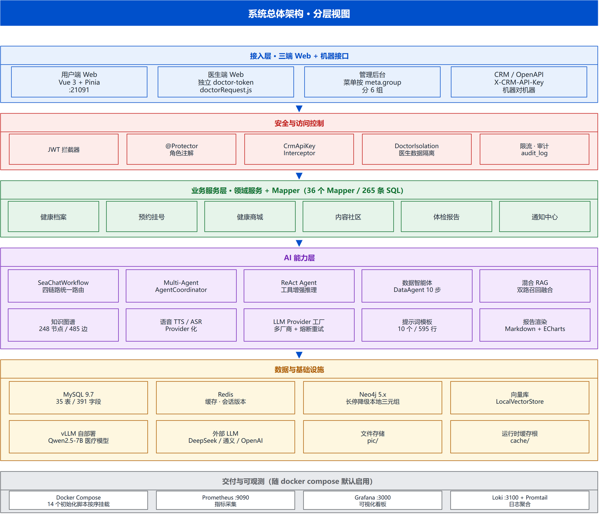
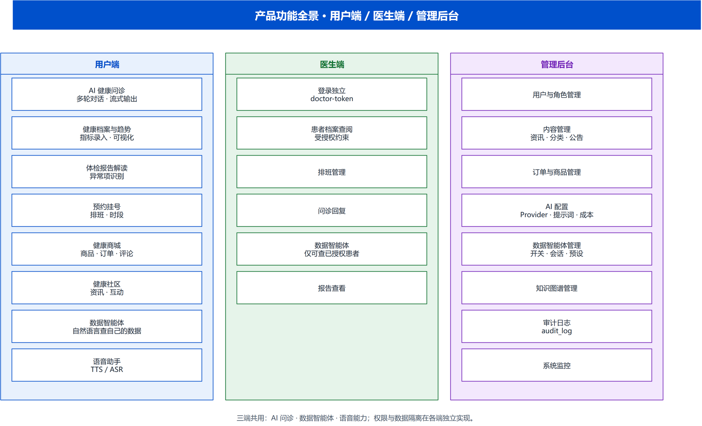
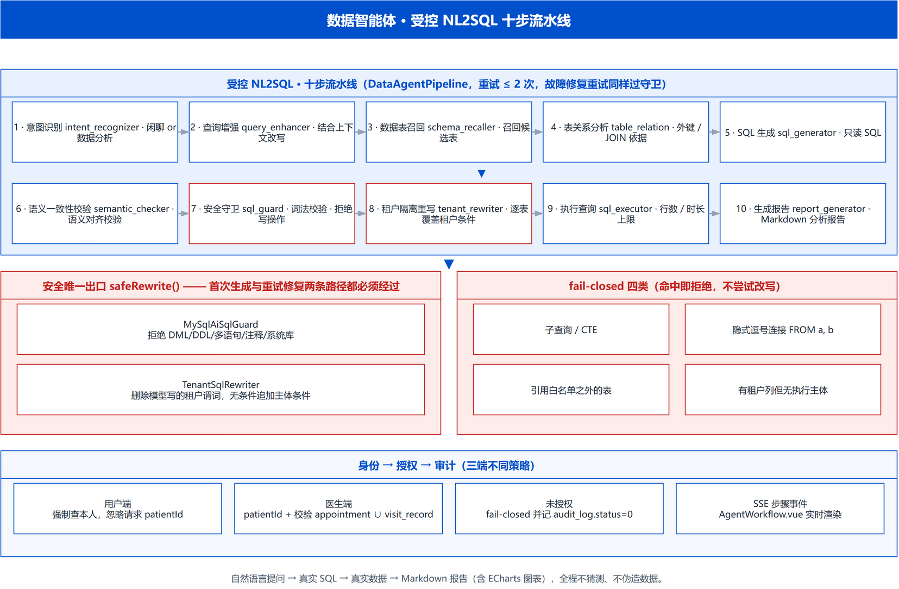
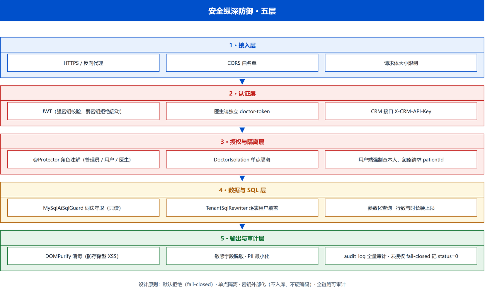
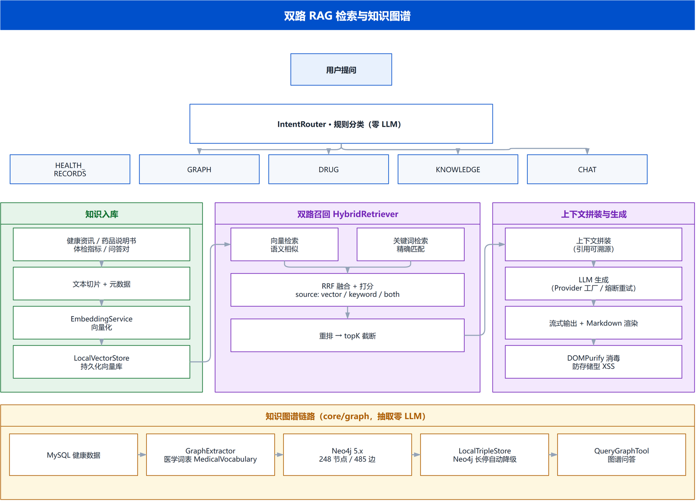
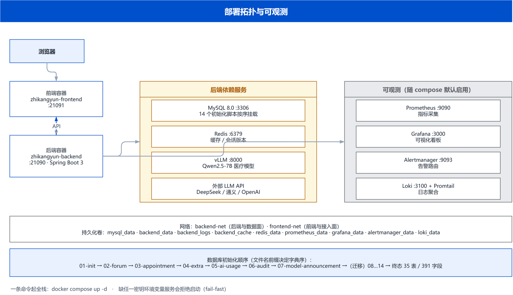

# VitalCortex — AI-Native 个人健康智能体平台

> 从 0 到 1 落地的 AI 应用工程实践：Multi-Agent 健康问诊 × 双路 RAG 检索 × 多模态交互 × 企业级安全加固。
> 让健康数据会说话，让 AI 医生常在身边。

    

基于 **Spring Boot 3.5 + Java 17 + Vue 3** 构建的 AI 健康平台：AI 智能问诊、**受控 NL2SQL 数据智能体**（自然语言查自己的数据 → 出报告）、知识库双路 RAG 检索、健康数据追踪、体检报告解读、预约挂号、健康商城与社区。支持 12 个国内 AI 厂商，通过 ReAct Agent 实现工具增强推理，并由覆盖 858 个用例的测试套件守住回归。

## 项目解决什么问题

健康咨询场景存在三个真实痛点，本项目逐一给出工程化答案：

| 痛点 | 本项目的答案 |
| --- | --- |
| 网上健康信息鱼龙混杂、真假难辨 | 双路 RAG 知识检索（向量 × 知识图谱 × 关键词），回答**带 `[ID]` 引用溯源**，可验证、可追溯 |
| 通用大模型医学不严谨，可能给出不负责任的用药建议 | 三层防幻觉门 + **自研微调医疗模型**（华佗 9k+ 数据 SFT + LoRA，医学准确性与安全性提升约 10%），云端/微调双轨制各取所长 |
| 个人健康数据零散、无结构，AI 无法利用 | 结构化健康模型 + JSON 导入导出 + 健康报告 PDF，AI 可读取真实数据做个性化分析 |

## 核心能力

| 能力 | 说明 |
| --- | --- |
| **Multi-Agent 健康问诊** | 医生/营养师/药师等角色协调器 + ReAct Agent（OpenAI function calling），工具轨迹落库，可观测可回放 |
| **双路 RAG 检索** | 向量语义（bge-m3）× Neo4j 知识图谱双路召回 + RRF 融合，回答带 `[ID]` 引用溯源 + RAGAS 评测 |
| **三层防幻觉** | `SynthesisGuard` 质量门（端水/重复检测）+ `OutputValidator` 合规门（剂量敏感/免责声明）+ `SignalDetector` 安全门（紧急就医提示） |
| **多模态交互** | 图片进上下文（VIP 512K / 普通 128K 分级窗口 + 预算管理）；语音 ASR/TTS Provider 化（设计就绪） |
| **企业级安全** | 会话版本号（锁定/登出/改密即旧 Token 失效）、JWT 外部注入、fail-closed 接口、SqlGuard 防注入、Sentinel 限流熔断 |
| **全链路可观测** | MDC traceId/userId 日志关联 + Prometheus/Grafana 指标看板 + Loki 日志聚合 + Alertmanager 告警 |
| **多厂商 AI 接入** | DeepSeek/通义/Kimi/GLM/豆包/MiniMax 等 12 家，Provider 工厂 + 熔断 + 自动重试，管理员界面热切换 |

## 系统架构



> 自上而下五层：三端接入 → 安全与访问控制 → 业务服务 → AI 能力 → 数据与基础设施。
> 图源 [`docs/assets/01-system-architecture.drawio`](docs/assets/01-system-architecture.drawio)，可用 draw.io 直接打开编辑。

**运行时组件与端口**

| 组件 | 说明 | 默认端口 |
|---|---|---|
| 前端 | Vue 3 + Vite（开发）/ Nginx 静态托管（生产） | 21091（dev）/ 80（Nginx） |
| 后端 | Spring Boot 3.5.16 + Java 17（context-path `/api/personal-health/v1.0`） | 21090 |
| MySQL | 业务主库（35 表） | 3306 |
| Redis | 缓存 + 会话版本号（登录/锁定/改密即失效） | 6379 |
| Neo4j | 知识图谱（可选；未启动时检索自动降级为纯向量） | 7687 |
| 本地微调模型 | vLLM 部署 `HealthPulse-Qwen2.5-7B`（可选） | 8000 |
| 监控栈 | Grafana / Prometheus / Alertmanager / Loki | 3000 / 9090 / 9093 / 3100 |

---

*项目源于 [程序员晨星](https://space.bilibili.com/1759570621) 的前后端教程，在其基础上迭代了 AI 智能问诊、CRM ReAct Agent、双路 RAG、多模态、安全加固等 Agent 能力，并持续重构为 AI-Native 架构。*

---

## 项目文档导航

> 项目开发过程中的全部文档，已扁平化至 `docs/` 根目录。
> 入口是 [`docs/文档索引与阅读指南.md`](docs/文档索引与阅读指南.md)：该读哪份、代码在哪、哪些内容已有更新，一张表看完。

| 文档           | 路径                                      | 说明                                           |
| ------------ | --------------------------------------- | -------------------------------------------- |
| **文档索引与阅读指南** | `docs/文档索引与阅读指南.md` | **入口文档**：该读哪份、代码在哪、哪些内容已有更新 |
| **项目现状基线** | `docs/项目现状基线.md` | 系统当前状态快照（2026-10-07 实测 35 表 / 391 字段；叠加 `07_mall_product_medical_fields`、`08_user_settings_columns` 后为 35 表 / 405 字段） |
| **数据表结构基线** | `docs/数据表结构基线-20261003.md` | 逐表逐字段清单（`information_schema` 导出） |
| **AI 智能体架构** | `docs/智能体架构.md` | **v5.1 新增** Multi-Agent / ReAct / Provider 工厂 / 熔断器 |
| **数据智能体迁移方案** | `docs/DataAgent集成迁移方案.md` | 受控 NL2SQL 的落地顺序与逐阶段实现 |
| **数据资产与 AI 能力整改方案** | `docs/数据资产与AI能力整改方案.md` | 能力建设与缺陷整改记录；**附录 §B** 承接原《缺陷与改进路线图》的待排期清单（S/F/E/A 编号） |
| **RAG 检索增强** | `docs/RAG子系统.md` | **v5.1 新增** ingestion 管线 / 混合检索 / RAGAS |
| **安全加固设计** | `docs/安全加固设计.md` | **v5.1 新增** JWT / CRM Key / SqlGuard / XSS / 脱敏 |
| **多模态能力设计** | `docs/多模态设计.md` | **v5.2 新增** 图片进上下文 + 语音 ASR/TTS Provider 化详细设计 |
| **通知系统** | `docs/通知系统.md` | **2026-10-10 新增** 用户通知开关接线、9 个触发点、去重键、就诊前一天定时任务 |
| 后端开发 | `docs/后端开发.md` | 接口设计、核心代码、架构说明 |
| 前端开发 | `docs/前端开发.md` | 页面设计、组件说明、路由设计 |
| 数据库设计 | `docs/数据库设计.md` | ER 图、建表 SQL、字段说明 |
| 需求分析 | `docs/需求分析.md` | 功能需求、用例图、流程图 |
| 架构调研与代码审查 | `docs/调研与代码审查报告-20261003.md` | 一次人工全量审查的结论与处置 |
| 测试报告 | `docs/测试报告.md` | 测试环境、用例清单、回归范围（用例数按时点分别记录，**合并后总数以本文档为准**） |
| Linux 部署 | `docs/Linux部署.md` | 环境搭建、部署命令、常见问题 |
| 开发指南 | `docs/开发指南.md` | 编码规范与防坑指南 |
| AI 工具使用记录 | `docs/AI工具使用记录.md` | 开发期 AI 工具使用实录（≥500 字） |
| ~~用户交付手册~~ | `DELIVERY.md`（已删除） | 2026-10-11 起「部署指南 / 配置说明 / 使用指南 / 故障排查」4 章并入本 README，其余章节与 README 重复故丢弃 |

> 本表**不再列出** `docs/项目状态.md` 与 `docs/缺陷与改进路线图.md`：两份旧文档已于 2026-10-07 的文档重构中删除，
> `origin/claude` 线 2026-10-10~12 写回它们的新内容已移植到权威文档 —— 变更表见 [`docs/项目现状基线.md`](docs/项目现状基线.md) §十一，
> 待排期清单（含 E1「无集成/E2E 测试」最新口径）见 [`docs/数据资产与AI能力整改方案.md`](docs/数据资产与AI能力整改方案.md) 附录 §B。

---

## 技术栈

| 层级  | 技术                                            |
| --- | --------------------------------------------- |
| 前端  | Vue 3 + Element Plus + ECharts + Vue Router   |
| 后端  | **Spring Boot 3.5.16 + Java 17** + MyBatis + MySQL 8 + Redis + SQLite（CRM 对话历史） |
| AI  | 12 个国内厂商（DeepSeek、通义千问、Kimi、GLM 等）+ 本地 vLLM 微调模型（可选，训练集与参数见 `ai_model/`，完整权重发布 Hugging Face + 魔搭（`Aulink/HealthPulse-Qwen2.5-7B`）） |
| 向量库 | 本地向量库（余弦相似度，规划迁移 pgvector HNSW）+ **bge-m3 嵌入（硅基流动）** + MySQL LIKE，**RRF 混合检索** |
| 知识图谱 | **Neo4j GraphRAG**（实体抽取 → 关系查询 → 注入上下文，双路召回已接入主链路） |
| 认证  | JWT（会话版本号，锁定/登出/改密即失效）+ CRM API Key（机器接口，fail-closed） |
| 智能体 | Multi-Agent 协调器 + ReAct Agent（OpenAI function calling + 工具轨迹落库） |
| RAG | 文章 ingestion 管线（分块→嵌入→入库）+ 向量/图谱/MySQL 混合检索 + RAGAS 评测 + 引用溯源 |
| 防幻觉 | **SynthesisGuard 三层防线**：质量门 + 合规门 + 安全门（已接入 chat/chatStream 输出端） |
| 多模态 | 图片进上下文（VIP 512K/普通 128K 分级窗口，TokenBudgetManager 预算管控） |
| 韧性  | LLM Provider 工厂 + 轻量熔断器（429/5xx 重试与快速失败）+ **Sentinel 限流**（登录/AI/上传） |
| 安全  | SqlGuard 只读 SQL 守卫（词法校验 + 租户隔离）+ DOMPurify XSS 净化 + PII 出境脱敏 + 上传魔数校验 |
| 可观测 | MDC traceId/userId + **Prometheus/Grafana/Loki/Alertmanager 监控告警栈**（docker-compose 一键起） |
| PDF | iText + JFreeChart（健康报告生成）                    |

---

## 产品功能全景



### 用户端

- **健康资讯** — 浏览、搜索、收藏健康文章，支持轮播图

- **健康指标** — 自定义健康模型，记录健康数据（血压、血糖、体重等），支持 JSON 导入导出

- **AI 健康分析** — 6 种 AI 角色（健康助手、全科医生、营养师、心理咨询师、报告分析师、全能助手），支持 Markdown 渲染、联网搜索、深度思考、知识库 RAG、健康数据读取

- **网站小助手** — 独立对话页面，内置意图识别（病情查询/医生推荐/药品介绍/健康知识），自动分流

- **药品订阅** — 浏览药品信息（价格、说明、分类），订阅关注的药品

- **健康报告** — 一键生成 PDF 健康报告，包含图表和 AI 建议

- **深色模式** — 支持深色/浅色主题切换

- **消息中心** — 系统通知与提醒

### 管理后台

- **仪表盘** — 用户增长、健康记录等统计图表

- **用户管理** — 用户信息 CRUD

- **资讯管理** — 健康文章 CRUD（富文本编辑器），支持轮播图和置顶设置

- **AI 配置管理** — 支持多厂商切换，配置持久化到 MySQL（重启不丢失）

- **AI 医生管理** — 修改各 AI 角色的系统提示词、Temperature、Top-P 参数

- **联网搜索配置** — 独立配置搜索引擎（博查AI、Tavily、DuckDuckGo等）

- **资讯管理** — 健康文章 CRUD（富文本编辑器），支持轮播图和置顶

- **药品管理** — 药品信息 CRUD，支持 JSON 批量导入

- **健康数据管理** — 查看和管理用户健康记录，支持 JSON 导入导出

- **评论/消息管理** — 评论审核、消息推送

### AI 工具增强

| 工具                 | 数据来源                            | 说明              |
| ------------------ | ------------------------------- | --------------- |
| `search_drug`      | `ai_data/drugs.json`            | 药品搜索，返回名称/价格/厂商 |
| `get_health_data`  | MySQL `user_health` 表（按指标字典白名单查询，LLM 不产 SQL） | 用户健康指标查询 |
| `search_knowledge` | 向量数据库 + MySQL                   | 知识库语义检索         |
| `web_search`       | 博查/Tavily/DuckDuckGo            | 联网搜索最新信息        |
| `get_chat_history` | SQLite                          | 查询聊天历史          |
| `execute_sql`      | SQLite                          | 只读 SQL 查询       |

---

## 网站小助手（基于CRM意图识别的智能助理）

- **五大核心功能**：
1. 药品推荐与价格查询（search_drug 工具，从JSON文件读取）

2. 推荐 AI 医生角色

3. 推荐健康资讯文章（向量语义检索）

4. 联网搜索获取最新信息（web_search 工具）

5. SQL 查询执行（execute_sql 工具）

内置意图识别引擎，根据用户输入自动分流：

| 用户输入        | 识别意图 | 处理方式         |
| ----------- | ---- | ------------ |
| "我发烧咳嗽怎么办？" | 病情查询 | 联网搜索         |
| "推荐合适的医生"   | 医生推荐 | 关键词匹配 → 快捷跳转 |
| "布洛芬价格多少"   | 药品介绍 | 调用药品数据库      |
| "高血压怎么调理"   | 健康知识 | AI + 知识库 RAG |

- **ReAct Agent** — 工具增强推理，支持 5 轮自主决策

- **本地向量数据库** — 文件存储 + 内存索引，余弦相似度搜索

- **SQLite 聊天记录** — 嵌入式数据库，零外部依赖

---

## 数据智能体（受控 NL2SQL）

自然语言提问 → 真实 SQL → 真实数据 → 分析报告。整条链路是**十步流水线**，两步安全动作（词法守卫 + 租户重写）是唯一出口，命中风险模式一律 fail-closed：



| 步骤 | 名称 | 职责 |
|---|---|---|
| 1 | 意图识别 | 判断是闲聊还是数据分析请求 |
| 2 | 查询增强 | 结合上下文把问题改写为独立、可检索的规范查询 |
| 3 | 数据表召回 | 从全库召回与问题相关的候选表 |
| 4 | 表关系分析 | 分析候选表的外键关系，为 JOIN / 子查询提供依据 |
| 5 | SQL 生成 | 依据 schema 与表关系生成只读 SQL |
| 6 | 语义一致性校验 | 校验 SQL 是否真正回答了用户问题 |
| 7 | 安全守卫 | 词法校验：拒绝 DML/DDL/多语句/注释/系统库/黑名单表 |
| 8 | 租户隔离重写 | 删除模型写的租户谓词，无条件追加当前主体条件 |
| 9 | 执行查询 | 参数化执行，行数与时长为硬上限 |
| 10 | 生成报告 | 基于真实结果生成 Markdown 分析报告（可含 ECharts 图表） |

> 三端入口：`/user/data-agent`、`/doctor/data-agent`、`/data-agent/admin`；
> 步骤事件经 SSE 实时推送到前端 `AgentWorkflow.vue`，全流程可见、可中断、可回看历史。

---

## AI 智能体架构（Multi-Agent + ReAct + 混合 RAG）

系统 AI 能力由三层构成，覆盖从意图路由到工具增强推理再到知识检索的完整链路。

### 1. Multi-Agent 协调（AgentCoordinator）

`AgentCoordinator` 作为 Supervisor 中枢，基于**外部化意图词表**将用户问题路由到最合适的专科 Agent：

```
用户输入 → AgentCoordinator（意图识别）
   ├── 全科医生 Agent  → 症状分析 + 分诊建议
   ├── 营养师 Agent    → 饮食规划
   ├── 心理咨询师 Agent → 情绪疏导
   ├── 报告分析师 Agent → 体检报告解读
   ├── 健康助手 Agent   → 通用健康咨询
   └── 全能助手 (default) → 兜底
```

> 意图词表已外部化到 `CrmConfig`，便于运维调整而不改代码。

### 2. ReAct Agent（工具增强推理）

对话中通过 **OpenAI function calling**（非正则解析）驱动 ReAct 循环，支持最多 5 轮自主决策，调用 6 个本地工具：

| 工具                 | 数据来源                            | 说明              |
| ------------------ | ------------------------------- | --------------- |
| `search_drug`      | `ai_data/drugs.json`            | 药品搜索，返回名称/价格/厂商 |
| `get_health_data`  | MySQL `user_health` 表（按指标字典白名单查询，LLM 不产 SQL） | 用户健康指标查询 |
| `search_knowledge` | 向量数据库 + MySQL                   | 知识库语义检索（混合）     |
| `web_search`       | 博查/Tavily/DuckDuckGo            | 联网搜索最新信息        |
| `get_chat_history` | SQLite                          | 查询聊天历史          |
| `execute_sql`      | SQLite（只读 + 租户隔离）               | 只读 SQL 查询       |

每一轮工具调用的**参数、结果、状态**都会随会话落库，支持审计回放（检查点能力已落地）。

### 3. 混合 RAG 检索

文章在发布时经 **ingestion 管线**（分块 `ChunkUtil` → 嵌入 `EmbeddingService` → 入库 `KnowledgeIngestionService`）自动灌入向量库；检索时采用**向量（余弦相似度）+ MySQL LIKE 双路召回，RRF 融合排序**，回答附引用溯源：

```
文章发布 → 分块 → 嵌入 → 向量库入库（ingestion 自动联动）
                          ↓
用户提问 → 向量召回 + MySQL LIKE 召回 → RRF 融合 Top-K
                          ↓
              注入 AI 上下文（带引用）→ 基于文章生成回答
                          ↓
              RAGAS 评测（真实检索 + LLM 打分：精确度/忠实度/相关性）
```

> RAG 质量看板（`/admin/ragMonitor`）展示真实 RAGAS 指标，替代了原先的模拟数据。

### 4. LLM Provider 工厂与韧性

通过 `LLMProviderFactory` 在运行时切换厂商，自带轻量熔断器与 429/5xx 重试：

- `DeepSeekProvider` — 云端 DeepSeek
- `LocalVllmProvider` — 自部署微调模型 `HealthPulse-Qwen2.5-7B`（vLLM，OpenAI 兼容，默认 `:8000`）；训练集/训练参数见 `ai_model/`，完整权重发布 Hugging Face + 魔搭（`Aulink/HealthPulse-Qwen2.5-7B`）（见 `ai_model/README.md`）
- `CircuitBreaker` — 故障快速失败、半开探测恢复

### 5. 安全加固



| 项 | 实现 |
|----|------|
| 密码存储 | BCrypt 加盐哈希 |
| 登录令牌 | JWT 密钥**外部注入**，启动强校验（空密钥/弱密钥直接拒绝启动），默认 7 天有效期；**会话版本号**——锁定/登出/改密即旧 Token 失效 |
| 会话越权 | AI 会话 / 文件上传均有归属校验（IDOR 已修复） |
| 机器接口 | `/crm/**` 由 `CrmApiKeyInterceptor` 做 API Key 认证，fail-closed |
| SQL 注入 | 双守卫：`SqlGuard` 只读词法校验 + 关键词黑名单 + 禁子查询 + **租户隔离**；数据智能体侧 `MySqlAiSqlGuard` + `TenantSqlRewriter` **逐表重写**，子查询 / CTE / 隐式逗号连接 / 白名单外表一律 **fail-closed** |
| 文件上传 | 登录态 + 扩展名白名单 + 魔数校验 + 随机文件名（不可枚举） |
| XSS | AI 输出统一经 DOMPurify 白名单净化（报告渲染走 `utils/markdownReport.js`，防存储型 XSS） |
| 数据出境 | 健康档案发送第三方 AI 前自动**脱敏**（剔除姓名/手机号等 PII） |
| LLM 稳定性 | Provider 工厂 + 熔断器（429/5xx 自动重试，故障快速失败）+ Sentinel 限流（登录/AI/上传） |
| 成本可观测 | 每次调用 token 用量落库（`ai_usage` 表） |
| 日志 | `TraceIdFilter` 注入 MDC `traceId`/`userId`，logback 滚动归档，异常不回传前端 |
| 单元测试 | 用例规模按时点分别为：我方 2026-10-07 基线 **405 个用例 / 38 个测试类全绿**（含 SqlGuard、NL2SQL 双守卫、数据智能体流水线），2026-10-11 P0-P2 合入后达 **541/541**；通知线 2026-10-10~12 自报 **364 例 `mvn -o test` 全绿**并另增一批后端测试。**2026-10-12 两条线合并后实测 `mvn -o -B test`：684 例 / 69 个测试类全绿**；**2026-10-15 合并 + claude 增强后实测 `mvn -o -B test`：858 例 / 86 个测试类全绿**（新增 RAG 知识库子系统与多智能体编排框架，均已编入并跑过）（口径仍全为 Mockito，零 `@SpringBootTest`），详见 [`docs/测试报告.md`](docs/测试报告.md) §7，另见「部署指南 · 测试」 |

> 测试位于 `后端/personal-health-api`；以 Mockito 纯对象测试为主，`@SpringBootTest` 仅 2 处（`GraphExtractorDbTest`、`MapperTableConsistencyTest`），Mapper XML 由 `MapperXmlParseTest` 静态兜底（该测试曾揪出服务启动阻断缺陷）。

**合规提醒**：平台涉及个人健康信息（敏感个人信息），正式商用前建议完成**等保三级测评**与个人信息保护影响评估，并对第三方 AI 厂商的数据出境做合规确认。

---

## RAG 知识库检索流程（双路召回）



```
用户提问 → 向量语义召回（bge-m3）+ Neo4j 图谱召回（实体关系）+ MySQL LIKE 召回
                    ↓
              RRF 融合排序 → Top-K 上下文
                    ↓
      注入 AI 上下文（文章引用溯源 + 图谱实体关系）→ 基于知识生成回答
```

> 图谱路未配置/未启动 Neo4j 时自动降级为纯向量 + LIKE，不抛错（`GraphRAG.isConnected()` 兜底）。

---

## 数据流设计

```
对话历史 → MySQL（主存储）+ chat_history/{userId}/conversation_{id}.json（本地副本）
AI调用数据 → MySQL → 导出JSON → AI工具读取
AI配置 → MySQL（明文存储，管理员后台管理）
语音对话历史 → chat_cache/history_speak/{年}/{月}/{日}/（Web Speech 降级路径）
```

---

## API 接口

### 用户接口（需 JWT 认证）

| 方法   | 接口                                | 说明           |
| ---- | --------------------------------- | ------------ |
| POST | `/user/login`                     | 登录           |
| POST | `/user/register`                  | 注册           |
| POST | `/user-health/save`               | 保存健康记录       |
| POST | `/user-health/import`             | JSON 导入健康记录  |
| GET  | `/user-health/export`             | JSON 导出健康记录  |
| POST | `/drug/query`                     | 查询药品         |
| POST | `/drug/subscribe/{id}`            | 订阅药品         |
| POST | `/ai/chat`                        | AI 对话（非流式）   |
| POST | `/ai/chat/stream`                 | AI 流式对话（SSE） |
| GET  | `/ai/conversations`               | 获取会话列表       |
| GET  | `/ai/conversations/{id}/messages` | 获取会话消息       |
| POST | `/ai/keywords/extract`            | 提取关键词（RAG）   |
| GET  | `/report/health-pdf`              | 下载健康报告       |

### 管理员接口

| 方法   | 接口                           | 说明              |
| ---- | ---------------------------- | --------------- |
| POST | `/ai/config/update`          | 更新 AI 配置        |
| POST | `/ai/config/switch-provider` | 切换 AI 厂商        |
| POST | `/data-export/all`           | 导出药品+健康数据到 JSON |
| POST | `/drug/save`                 | 新增药品            |
| PUT  | `/drug/update`               | 修改药品            |

### 数据导出接口（管理员）

| 接口                             | 说明                         |
| ------------------------------ | -------------------------- |
| `/data-export/drugs`           | 导出药品到 `ai_data/drugs.json` |
| `/data-export/health/{userId}` | 导出指定用户健康数据                 |
| `/data-export/health/all`      | 导出所有用户健康数据                 |

### CRM 接口（机器对机器，`X-CRM-API-Key` 认证）

| 方法 | 接口 | 说明 | 认证 |
|----|------|------|------|
| POST | `/crm/chat` | 非流式对话 | X-CRM-API-Key |
| POST | `/crm/chat/stream` | 流式对话（SSE） | X-CRM-API-Key |
| GET | `/crm/history/{phone}` | 指定手机号对话历史 | X-CRM-API-Key |
| POST | `/crm/sql/query` | 只读 SQL 查询 | X-CRM-API-Key |
| GET | `/crm/health` | 健康检查 | 免认证 |

> CRM 接口面向运营 / 客服与第三方系统集成；`execute_sql` 等工具已强制**租户隔离**（只能查询当前会话手机号的数据）。

### 数据智能体接口（三端，SSE 步骤事件）

| 端 | 前缀 | 端点 |
|---|---|---|
| 用户 | `/user/data-agent` | `POST /ask`（SSE）、`GET /sessions`、`GET /sessions/{id}/messages`、`PUT /sessions/{id}/rename`、`DELETE /sessions/{id}`、`DELETE /sessions`、`GET /presets` |
| 医生 | `/doctor/data-agent` | 同上（**必传 `patientId`**，校验 `appointment ∪ visit_record` 授权，未授权 fail-closed 并落审计） |
| 管理员 | `/data-agent/admin` | 开关与运行时配置、预设问题、指标字典 |

> 协议：`event: step | result | error`；`step` 事件携带 `RUNNING / SUCCESS / FAILED / SKIPPED` 与 thinking、payload、elapsedMs。
> 前端不使用 `EventSource`（不支持 POST），改 `fetch` + `ReadableStream` 手工解帧（`utils/agentStream.js`）。

---

## AI 多厂商支持

| 厂商                     | 主力模型                               |
| ---------------------- | ---------------------------------- |
| **DeepSeek**           | deepseek-v4-flash, deepseek-v4-pro |
| **Moonshot AI (Kimi)** | kimi-k2.6                          |
| **智谱AI (GLM)**         | glm-5.1, glm-4.7                   |
| **阿里云 (通义千问)**         | qwen3.7-max, qwen-plus             |
| **MiniMax**            | MiniMax-M2.7                       |
| **百度 (文心一言)**          | ernie-5.0                          |
| **字节跳动 (豆包)**          | doubao-seed-2.0-pro                |
| **腾讯 (混元)**            | hunyuan-turbo                      |
| **零一万物 (Yi)**          | yi-large                           |
| **百川智能**               | baichuan-4                         |
| **阶跃星辰**               | step-2-16k                         |
| **小米 (MiMo)**          | mimo-v2.5                          |

---

## 模型微调（HealthPulse-Qwen2.5-7B 自部署医疗大模型）

除云端多厂商接入外，项目内置一条**从数据到部署的完整本地微调链路**，作为「双轨制」中更专注医学严谨性的一轨：

### 为什么微调

通用大模型在医学场景存在两个短板：**专业术语表达不规范**、**安全性不足（可能给出不负责任的用药建议）**。通过领域微调让模型"更像医生"——用华佗医患数据强化医学知识，重点提升医学准确性与安全性指标。

### 技术栈与平台

| 环节 | 选型 | 说明 |
| --- | --- | --- |
| 训练平台 | **华为云 A800（80GB）GPU 租借** | 个人项目资源有限，本地跑不动，采用云上单卡训练 |
| 训练框架 | **LLaMA-Factory** | 开源 SFT/LoRA 生态，Qwen 适配成熟 |
| 基座模型 | **Qwen2.5-7B-Instruct** | 生态成熟的老牌模型，社区验证充分、环境问题少，7B 单卡可训 |
| 微调方法 | **LoRA + SFT** | rank=8, alpha=16, lr=5e-5；只训低秩适配层，显存/时间成本低一个量级 |
| 训练数据集 | **Huatuo（华佗）医患数据集 9,000+ 条** | 中文医疗问答，Alpaca 格式 |
| 数据清洗 | **Hadoop + Spark + Hive + PySpark** + Dify 工作流（GPT-4o-mini 多维打分） | 批处理清洗 + LLM 质量过滤 |
| 评测体系 | **5 维 NLU** + 三级评分 | 准确性/专业性/安全性/完整性/清晰度 |
| 推理部署 | **vLLM**（OpenAI 兼容） | 与 `LocalVllmProvider` 无缝对接，管理员后台一键切换 |

### 数据管线（9,000+ 条）

1. 华佗原始医患数据体量大但质量参差，先经 **Hive 暂存 + PySpark 清洗**，转换为符合 LLaMA-Factory 要求的 **Alpaca JSON** 格式
2. 用 **Dify 工作流 + GPT-4o-mini 多维打分**（医学准确性 / 回答长度 / 专业术语数量 / 是否参考经典书籍论文 / 完整性），强制 **≥ 6.0 分**，保留比例控制在 90%-95%，剔除低质样本
3. 划分 7000 train / 1000 val / 1000 test，注册进 LLaMA-Factory 数据集配置

### 评测体系（5 维 NLU）

| 维度 | 含义 | 评分方式 |
| --- | --- | --- |
| 医学准确性 | 是否符合医学共识 | LLM 初审 + 医学论坛评分 + 争议样本医学人士复核 |
| 专业性 | 是否体现医生角色 | 同上三级流程 |
| 安全性 | 是否不乱开药/给危险建议 | 同上三级流程 |
| 完整性 | 是否覆盖关键信息 | DeepSeek 打分 |
| 清晰度 | 表达是否流畅 | DeepSeek 打分 |

### 效果与双轨制

- **优势**：安全性、医学准确性比云端最新国产模型**高约 10%**（领域知识更聚焦）
- **短板**（如实记录）：完整性、清晰度**低 10%-20%**（基座较老）；华佗数据为 3 年前，**前沿医学问题弱于最新模型**
- **双轨制**：用户咨询时可自主选择「平台大模型（表达好/知识新，如 DeepSeek）」或「微调模型（医学严谨/安全性高）」，各取所长

### 发布与资源

- 训练集、训练参数、微调步骤/排障/部署指南、推理评测脚本 → 仓库 `ai_model/`
- 完整权重（29GB）→ 双平台发布：**[ModelScope 魔搭](https://www.modelscope.cn/models/Aulink/HealthPulse-Qwen2.5-7B)（国内直连）** + [Hugging Face](https://huggingface.co/Weikaijie/HealthPulse-Qwen2.5-7B)（海外）
- 实操全流程见 `ai_model/微调步骤.md`，云上部署见 `ai_model/部署指南-vLLM-阿里云.md`

---

### 联网搜索支持

支持 6 种搜索引擎，管理员可独立配置：

| 搜索引擎 | 费用 | 说明 |

|----------|------|------|

| **自动** | - | 优先博查→Tavily→DuckDuckGo |

| **博查AI** | 免费额度 | 国内医疗优化，推荐 |

| **Tavily** | 1000次/月免费 | 国际搜索，专为AI设计 |

| **DuckDuckGo** | 完全免费 | 无需API Key |

| **Serper** | 100次/月免费 | Google搜索API |

| **SerpAPI** | 100次/月免费 | Google/Bing搜索 |

---

## 核心难点与解决方案

| 难点 | 解决方案 |
| --- | --- |
| Spring Boot 2 → 3 升级，javax→jakarta 全量迁移、隐藏坑多 | OpenRewrite 自动化迁移；修复 `spring.data.redis` 前缀、SQLite + HikariCP 6 `setReadOnly` 冲突（移除 JDBC 只读标志） |
| 通用模型医学不严谨、安全性不足 | 华佗数据 PySpark 清洗 + Dify + GPT-4o-mini 多维打分（≥6.0 保留 90%-95%）；LoRA 微调 Qwen2.5-7B，5 维 NLU 评测，医学准确性/安全性提升约 10% |
| RAG 回答"凭感觉"、无出处、易幻觉 | 向量 × 图谱 × 关键词三路召回 + RRF 融合 + `[ID]` 引用溯源 + SynthesisGuard 三层防幻觉门 + RAGAS 真实评测 |
| 个人项目资源有限，本地训不动 7B | 华为云 A800 租借单卡训练；LoRA 低秩适配（rank=8）显存/成本低一个量级；权重双平台发布（魔搭 + HF） |
| 12 家厂商 API 形态各异，切换成本高 | LLM Provider 工厂 + 轻量熔断器（429/5xx 重试与快速失败），管理员后台热切换 |
| 健康数据出境与注入风险 | PII 脱敏（剔除姓名/手机号）+ DOMPurify XSS 净化 + SqlGuard 只读 SQL 守卫 + 租户隔离 |
| 密钥安全 | JWT 密钥 / CRM Key / 嵌入密钥外部注入，缺失或弱密钥**拒绝启动**；会话版本号实现"锁定/登出/改密即失效" |
| 跨境外传 15GB 权重屡传屡崩 | 国内镜像 hf-mirror 通道 + Xet 高性能续传（`HF_XET_HIGH_PERFORMANCE=1`），避开代理僵死与单请求不可续传的坑 |

---

## 快速启动

> **最快体验路径**：`docker-compose up -d`（MySQL/Redis/监控栈）→ 初始化数据库 → 启动后端 `mvn spring-boot:run` → 启动前端 `npm run dev` → 管理后台配置 AI Key 即可对话。详细步骤见下。

### 环境要求

- JDK 17（构建/运行目标，pom `source/target=17`）
- Maven 3.6+
- Node.js 18+（本项目在 Node 22 上验证）
- MySQL 8.x（主库，HikariCP 连接池；本项目在 MySQL 9.7 验证）
- Redis 6+（缓存 + 会话版本号，必需）
- Neo4j（可选，GraphRAG 双路召回；未启动时自动降级为纯向量检索）
- Docker（可选，一键起监控告警栈：Prometheus/Grafana/Loki/Alertmanager，见本文档「部署指南 · 监控、告警与日志」）

### 1. 数据库初始化

```sql
-- 库默认排序规则与生产库实测一致（utf8mb4_bin）。
-- 注意：35 张表 / 130 个字符列的 utf8mb4_0900_ai_ci 由各建表脚本在 DDL 里**显式指定**，
-- 所以这里的库默认值不影响终态结构。
CREATE DATABASE personal_health DEFAULT CHARACTER SET utf8mb4 COLLATE utf8mb4_bin;
USE personal_health;

-- ① 建库建表（7 个脚本）→ 42 张表（未合并前的初始结构）
source Data/01_建库建表/init_database.sql;
source Data/01_建库建表/forum_schema.sql;
source Data/01_建库建表/appointment_schema.sql;
source Data/01_建库建表/extra_modules_schema.sql;
source Data/01_建库建表/ai_usage_schema.sql;
source Data/01_建库建表/audit_log.sql;
source Data/01_建库建表/model_announcement_schema.sql;

-- ② 增量升级（7 个脚本，按序执行且全部幂等）→ 终态 35 张表 / 391 字段
source Data/02_迁移脚本/01_schema_refactor.sql;
source Data/02_迁移脚本/02_patient_profile_normalize.sql;
source Data/02_迁移脚本/03_align_demo_appointments.sql;   -- 演示数据，生产勿执行
source Data/02_迁移脚本/04_consolidate_tables.sql;
source Data/02_迁移脚本/05_drop_unused_tables.sql;
source Data/02_迁移脚本/06_merge_message_into_notification.sql;
source Data/02_迁移脚本/07_mall_product_medical_fields.sql;
```

`Data/01_建库建表/rbac_schema.sql` 已于 2026-10-07 移入 `Data/90_归档/`（它会建 4 张本项目从未使用的 RBAC 表），**不要执行**。
容器化部署（`docker compose up`）已把上述 14 个脚本按序挂载到 `/docker-entrypoint-initdb.d/`，无需手工执行。完整说明与备份恢复见 [`Data/README.md`](Data/README.md)。

### 2. 配置密钥（本地开发）

```bash
# 复制配置模板（application.yml 已被 gitignore，不会误提交真实密钥）
cp 后端/personal-health-api/src/main/resources/application-example.yml \
   后端/personal-health-api/src/main/resources/application.yml

export JWT_SECRET=$(openssl rand -hex 48)      # JWT 签名密钥（≥32 字节，启动强校验）
export CRM_API_KEY=$(openssl rand -hex 32)     # CRM 机器接口密钥（≥24 字符）
export EMBEDDING_API_KEY=sk-xxx                # 嵌入服务密钥（硅基流动 bge-m3 等）
```

> 本地开发可设置 `CRM_STRICT_STARTUP=false`（或配置 `crm.strict-startup: false`）跳过启动强校验；
> 生产必须保持默认严格校验（未配置密钥拒绝启动）。

### 3. 启动后端

```bash
cd 后端/personal-health-api
mvn spring-boot:run
```

### 4. 启动前端

```bash
cd 前端/personal-heath-view
npm install
npm run dev
```

### 5. 首次配置

1. 用种子管理员账号 `admin` 登录（密码见 `Data/01_建库建表/init_database.sql` 注释，首次登录后请立即修改）
2. 进入管理员后台 → AI 配置：选择厂商（如 DeepSeek）、输入 API Key、配置嵌入服务（Embedding API URL + Key）
3. 保存配置后即可开始 AI 对话

---

## 部署指南



### 1. Docker Compose（推荐）

前置：Docker + Docker Compose；准备 `.env` 文件（见「配置说明」）。

```bash
# 1. 准备环境变量（务必设置，缺任一密钥服务会拒绝启动）
cat > .env << 'EOF'
DB_ROOT_PASSWORD=你的MySQL密码
JWT_SECRET=至少32字节随机字符串（openssl rand -base64 48）
CRM_API_KEY=至少24字符随机字符串（openssl rand -hex 32）
EMBEDDING_API_URL=嵌入服务地址（可选，RAG 向量检索用）
AI_API_KEY=DeepSeek等厂商密钥
GRAFANA_ADMIN_PASSWORD=Grafana管理员密码（≥8位强密码，监控看板登录用）
EOF

# 2. 启动
docker compose up -d --build

# 3. 验证（存活探测）
curl http://localhost:21090/api/personal-health/v1.0/user/login
```

### 2. 裸机部署

```bash
# 后端
cd 后端/personal-health-api
mvn package -DskipTests
export JWT_SECRET=... CRM_API_KEY=... DB_PASS=...
java -jar target/*.jar

# 前端
cd 前端/personal-heath-view
npm ci && npm run build   # 产物在 dist/，交给 Nginx 托管
```

### 3. 关键运维事项

- **镜像/进程以非 root 运行**（后端镜像已内置 appuser）
- **数据卷持久化**：`backend_data`（上传文件）、`mysql_data`、`redis_data`、`grafana_data` / `loki_data`（监控数据）
- **备份清单**：MySQL 全库（`mysqldump`，或用 Navicat 生成 `.nbak`）；恢复与全新部署脚本见 [`Data/README.md`](Data/README.md)
- **前端端口**：生产由 Nginx 托管（80），开发环境 Vite 跑在 **21091**，反向代理需把 `/api` 转发到后端 21090、WebSocket `/ws` 转发到前端

### 4. 监控、告警与日志采集（随 compose 默认启用）

| 组件 | 端口 | 入口 | 说明 |
|------|------|------|------|
| Grafana | 3000 | `http://<主机>:3000` | 指标看板 + 日志查询，登录用 `.env` 的 `GRAFANA_ADMIN_PASSWORD` |
| Prometheus | 9090 | `http://<主机>:9090` | 指标抓取与告警规则管理 |
| Alertmanager | 9093 | `http://<主机>:9093` | 告警通知分发 |
| Loki | 3100 | `http://<主机>:3100` | 日志存储（保留 7 天），一般经 Grafana 访问 |

- **指标看板**：Grafana 已预置数据源（Prometheus/Loki）与「Spring Boot 应用概览（智康云）」看板（JVM 堆 / CPU / HTTP QPS / 5xx / 线程 / 启动时长），打开即用。
- **告警规则**（`deploy/prometheus-alerts.yml`，5 条）：后端实例离线（critical）、HTTP 5xx 速率过高、进程 CPU >85%、JVM 堆 >85%、监控目标离线。触发后在 Prometheus「Alerts」页可见，并推送 Alertmanager。
- **告警外发（上线前必改）**：编辑 `deploy/alertmanager.yml`，把 `url` 换成企业微信 / 钉钉 / 飞书机器人 Webhook，然后 `docker compose restart alertmanager`。**未替换前告警只在 Alertmanager 页面停留，不会外发**。
- **日志查询**：Grafana → 左侧 Explore → 数据源选 Loki，按 `service="backend"` 过滤；日志带 `traceId` / `userId`，可与错误响应中的「追踪ID」关联排查。
- **关闭监控栈**：删除 `docker-compose.yml` 中 grafana / alertmanager / loki / promtail 四个服务块及其数据卷声明即可（不影响业务）。

### 5. 测试

```bash
# 后端：javac + 自写 RunAll（本项目不用 mvn 跑测试，见 docs/开发指南.md）
#   当前规模：858 个用例 / 86 个测试类，全量通过

# 前端：静态自检（模板标签栈式配平 + <script> 交 node --check）
python 前端/personal-heath-view/selfcheck.py
```

---

## 配置说明

### 1. 必须配置（缺失即拒绝启动）

| 配置项 | 环境变量 | 说明 |
|--------|----------|------|
| JWT 密钥 | `JWT_SECRET` | ≥32 字节随机串，用于签发登录令牌 |
| CRM API Key | `CRM_API_KEY` | ≥24 字符，保护 `/crm/**` 机器接口 |
| MySQL 密码 | `DB_ROOT_PASSWORD` | 数据库 root 密码 |
| 嵌入服务地址 | `EMBEDDING_API_URL` | 向量检索用（DeepSeek 无此接口，需 OpenAI 兼容或本地服务） |
| Grafana 管理员密码 | `GRAFANA_ADMIN_PASSWORD` | 监控看板登录密码（≥8 位，随 compose 启动 Grafana） |

> 本地开发可设 `CRM_STRICT_STARTUP=false`（或 `crm.strict-startup: false`）跳过启动强校验；**生产必须保持默认严格校验**。

### 2. 可选配置

| 配置项 | 环境变量 / 键 | 默认值 |
|--------|-------------|--------|
| AI 厂商 | `AI_PROVIDER` | deepseek（可选 `zhikangyun-local` 切本地 vLLM 微调模型，地址 `http://localhost:8000/v1`） |
| AI 密钥 | `AI_API_KEY` | 空（也可在管理员后台配置，持久化到 MySQL） |
| 文件存储根 | `FILE_STORAGE_ROOT` | `/app/data`（容器） |
| 对外文件 URL | `my-server.public-base-url` | localhost（**生产必须改为域名**） |
| 嵌入模型 | `EMBEDDING_MODEL` | text-embedding-3-small（本项目用 bge-m3） |
| 监控端口 | `GRAFANA_PORT` / `ALERTMANAGER_PORT` / `LOKI_PORT` | 3000 / 9093 / 3100 |
| Grafana 访问地址 | `GRAFANA_ROOT_URL` | http://localhost:3000（生产改为域名） |

### 3. 安全配置基线

- 生产环境**必须 HTTPS**（语音输入 `getUserMedia` 仅 HTTPS 可用）
- 反向代理需把 `/api` 转发到后端 21090、WebSocket `/ws` 转发到前端
- 前端 `VUE_APP_API_BASE` 生产建议 `/api/personal-health/v1.0`（相对路径走反代）

---

## 使用指南

### 1. AI 问诊

1. 登录后进入「AI 健康分析」页
2. 选择角色（全科医生 / 营养师 / 心理咨询师 / 报告分析师 / 全能助手 / 健康助手）
3. 输入症状，或按住麦克风说话
4. 可勾选「联网搜索」「知识库」「健康数据接入」增强回答
5. AI 回答末尾会附相关文章推荐

### 2. 健康数据

- 「健康指标」页录入指标（血压/血糖/血脂/体重等，支持自定义模型）
- AI 问诊开启「健康数据接入」后，模型可基于真实指标给出个性化建议
- 支持 JSON 导入导出迁移数据

### 3. 体检报告解读

1. 上传 PDF 体检报告（≤50MB、≤100 页）
2. 系统自动提取血压、血糖、BMI、心率等指标
3. 交由「报告分析师」角色解读

> 注意：自动提取结果请人工核对，异常指标以医院报告为准。

### 4. 数据智能体（自然语言查数据 → 报告）

- **用户端**：在「我的数据」中以自然语言提问（如「我最近的血压趋势如何？」），流水线会展示 10 个步骤的实时进度，最终给出可下载的 Markdown / HTML 报告（图表可导出为图片）
- **医生端**：医生端数据问答页，**必须选定患者**，越权访问会被拒绝并记审计
- **管理员端**：数据智能体管理页可开关能力、维护预设问题与指标字典

### 5. 语音

- **输入**：输入框右侧麦克风按钮，按住说话松开识别（Chrome / Edge；Safari / Firefox 提示降级）
- **朗读**：AI 回答支持语音朗读（浏览器内置 Web Speech API，不占用服务器资源）

---

## 故障排查

| 症状 | 排查 |
|------|------|
| 服务拒绝启动 | 检查 `JWT_SECRET` / `CRM_API_KEY` / `EMBEDDING_API_URL` 是否设置且强度达标 |
| 登录后请求 401 | token 过期（默认 7 天）或会话版本被递增（重登/改密/被锁定）导致旧 token 失效 |
| 点任何页面跳登录 | 同上，通常是会话版本被顶或 Redis 停机后版本校验失效 |
| AI 无响应 | 检查 `ai_config` 表 API Key 与上游厂商余额；后端日志 `logs/error.log` |
| 图片/文件上传失败 | 检查登录态、文件类型（扩展名 + 内容须一致）、存储目录可写 |
| 上传文件 404 | 容器重启后存储卷未挂载（检查 `FILE_STORAGE_ROOT` 指向持久卷） |
| 语音按钮无反应 | 浏览器须为 Chrome / Edge，且页面须为 HTTPS 或 localhost |
| 药品搜索无结果 | 检查 `ai_data/drugs.json` 是否存在且有数据，或调用 `POST /data-export/drugs` 重新导出 |
| 页面空白 | 后端是否启动（21090）；前端 API 地址是否正确（`utils/request.js`）；浏览器控制台报错 |
| `Port 21090 in use` | 残留 java 进程，`netstat -ano \| grep :21090` 后 taskkill |
| `UnsupportedClassVersionError` | 用了 JDK 8，需切 JDK 17 |

---

## 数据库表结构

> **完整 35 表 / 391 字段的权威清单见 [`docs/数据表结构基线-20261003.md`](docs/数据表结构基线-20261003.md)**（`information_schema` 实时导出，改表前必须先更新）。
> 本节仅列核心表的关键字段，便于快速理解数据模型。

### 用户表 `user`

| 字段           | 类型           | 说明             |
| ------------ | ------------ | -------------- |
| id           | INT UNSIGNED, 主键 | 用户ID        |
| user_account | VARCHAR(50)  | 用户账号（登录名；`user.phone` 多为 NULL，登录一律用本字段） |
| user_name    | VARCHAR(50)  | 用户昵称           |
| user_pwd     | VARCHAR(100) | 密码（BCrypt 加密）  |
| user_role    | INT          | 角色：1=管理员, 2=用户, 3=医生 |
| user_avatar  | VARCHAR(255) | 头像URL          |
| user_email   | VARCHAR(100) | 邮箱             |
| phone        | VARCHAR(20)  | 手机号（可空）        |
| phone_verified | TINYINT    | 手机号是否已验证：0 未验证 / 1 已验证 |
| is_login     | TINYINT(1)   | **是否允许登录**：0=可登录, 1=锁定禁止 |
| is_word      | TINYINT(1)   | 禁言：0=正常, 1=禁言  |
| is_vip       | TINYINT(1)   | VIP：0=否, 1=是    |
| vip_expire_time | DATETIME  | VIP 到期时间（NULL=永久） |
| create_time  | DATETIME     | 创建时间           |

### 健康资讯表 `news`

| 字段          | 类型           | 说明              |
| ----------- | ------------ | --------------- |
| id          | INT UNSIGNED, 主键 | 内容ID         |
| content_type | VARCHAR(20) | 内容类型：NEWS 资讯 / POST 帖子 / ARTICLE 文章 |
| user_id     | INT UNSIGNED | 作者用户ID（资讯可为空）    |
| title       | VARCHAR(200) | 标题（统一字段，`name` 为迁移期并存列） |
| name        | VARCHAR(200) | 标题              |
| content     | LONGTEXT     | 内容              |
| summary     | VARCHAR(500) | 摘要 / 导读         |
| tag_id      | INT          | 分类ID（关联 `tags` 表） |
| cover       | VARCHAR(255) | 封面图URL          |
| view_count / like_count / favorite_count / comment_count | INT | 互动计数 |
| hot_score   | DECIMAL(10,4) | 热度分（定时任务维护）     |
| is_top      | TINYINT(1)   | 是否置顶            |
| is_banner   | TINYINT(1)   | 是否轮播图           |
| status      | TINYINT      | 状态：0 草稿 / 1 已发布 / 2 已下架 |
| create_time | DATETIME     | 创建时间            |

> 原 `post` 表已合并进本表（`content_type='POST'`），原 `news_save` 收藏已并入 `content_interaction`。

### 资讯分类表 `tags`

| 字段   | 类型          | 说明   |
| ---- | ----------- | ---- |
| id   | INT UNSIGNED, 主键 | 分类ID |
| name | VARCHAR(50) | 分类名称 |
| type | VARCHAR(20) | GENERAL 通用 / POST 论坛 / NEWS 资讯 |
| sort_order | INT   | 排序权重（小在前） |
| status | TINYINT   | 状态：0 禁用 / 1 启用 |

### 药品 / 商品表 `mall_product`

> 原 `drug` 表已并入 `mall_product`（`product_type='drug'`），药品与商城统一建模。

| 字段            | 类型            | 说明                  |
| ------------- | ------------- | ------------------- |
| id            | INT UNSIGNED, 主键 | 商品ID            |
| category_id   | INT           | 分类ID                |
| product_type  | VARCHAR(20)   | 商品类型：drug 药品 / device 医疗器械 / health 保健品 |
| name          | VARCHAR(200)  | 商品名称                |
| generic_name  | VARCHAR(200)  | 通用名（药品专用，源 `ai_data/drugs.json`） |
| specification | VARCHAR(200)  | 规格（如 0.4g×30片）      |
| manufacturer  | VARCHAR(200)  | 生产厂家                |
| is_otc        | TINYINT(1)    | 是否 OTC 非处方药（0=否, 1=是） |
| medical_category | VARCHAR(50) | 医学分类（中成药/感冒药/抗生素/维生素等），仅药品有值 |
| description   | TEXT          | 商品描述                |
| price / original_price | DECIMAL(10,2) | 售价 / 原价      |
| stock / sales_count | INT UNSIGNED | 库存 / 销量       |
| unit          | VARCHAR(50)   | 单位（盒/瓶/支）           |
| status        | TINYINT(1)    | 状态（0=下架, 1=上架）      |
| is_hot / is_new | TINYINT(1)  | 是否热销 / 是否新品        |

### 商城订单表 `mall_order`

> 原 `drug_subscription`（药品订阅）已由商城订单模型取代。

| 字段          | 类型       | 说明             |
| ----------- | -------- | -------------- |
| id          | INT UNSIGNED, 主键 | 订单ID     |
| order_no    | VARCHAR(50) | 订单号          |
| user_id     | INT      | 用户ID           |
| total_amount / actual_amount | DECIMAL(10,2) | 订单总额 / 实付金额 |
| status      | TINYINT(1) | 0 待付款 / 1 已付款 / 2 已发货 / 3 已收货 / 4 已完成 / 5 已取消 |
| payment_method | VARCHAR(50) | 支付方式（模拟）    |
| payment_time | DATETIME | 支付时间           |
| shipping_address_id | INT | 收货地址ID      |
| create_time | DATETIME | 创建时间           |

### 健康模型配置表 `health_model_config`

| 字段          | 类型          | 说明                |
| ----------- | ----------- | ----------------- |
| id          | INT UNSIGNED, 主键 | 模型ID          |
| user_id     | INT         | 用户ID（NULL = 全局模型）  |
| name        | VARCHAR(100) | 指标名称（如"收缩压"）      |
| detail      | VARCHAR(500) | 指标描述              |
| unit        | VARCHAR(50) | 单位（如"mmHg"）       |
| symbol      | VARCHAR(100) | 符号                |
| value_range | VARCHAR(100) | 正常范围（格式："90,140"） |
| is_global   | TINYINT(1)  | 是否全局（0=否, 1=是）     |
| category    | VARCHAR(20) | PUBLIC 公共 / PERSONALIZED 个性化 |

### 用户健康记录表 `user_health`

| 字段                     | 类型          | 说明     |
| ---------------------- | ----------- | ------ |
| id                     | INT UNSIGNED, 主键 | 记录ID |
| user_id                | INT         | 用户ID   |
| health_model_config_id | INT         | 健康模型ID |
| value                  | VARCHAR(100) | 记录值   |
| create_time            | DATETIME    | 记录时间   |

### AI 会话表 `ai_conversation`

| 字段                | 类型           | 说明                                    |
| ----------------- | ------------ | ------------------------------------- |
| id                | INT UNSIGNED, 主键 | 会话ID                            |
| user_id           | INT          | 用户ID                                  |
| title             | VARCHAR(255) | 会话标题                                  |
| agent_type        | VARCHAR(50)  | AI 角色 / 智能体类型（`doctor`、`DATA_AGENT_USER`、`DATA_AGENT_DOCTOR` 等） |
| message_count     | INT          | 消息数量                                  |
| last_message_time | DATETIME     | 最后消息时间                                |
| create_time / update_time | DATETIME | 创建 / 更新时间                        |

### AI 聊天记录表 `ai_chat_record`

| 字段              | 类型          | 说明                 |
| --------------- | ----------- | ------------------ |
| id              | INT UNSIGNED, 主键 | 记录ID         |
| conversation_id | INT         | 关联会话ID             |
| user_id         | INT         | 用户ID               |
| role            | VARCHAR(20) | 角色（user / assistant） |
| content         | TEXT        | 消息内容               |
| agent_type      | VARCHAR(50) | AI角色类型             |
| create_time     | DATETIME    | 创建时间               |

### AI 配置表 `ai_config`

| 字段           | 类型           | 说明                    |
| ------------ | ------------ | --------------------- |
| id           | INT, 主键      | 配置ID                  |
| config_key   | VARCHAR(100) | 配置键（如 api_key, model） |
| config_value | TEXT         | 配置值（API Key 明文存储，生产建议信封加密） |
| description  | VARCHAR(255) | 配置描述                  |
| create_time / update_time | DATETIME | 创建 / 更新时间      |

### 评论表 `comment` / 通知表 `notification` / 内容交互表 `content_interaction`

> 原 `evaluations`（评论）已于 2026-10-03 并入 `comment`（迁移脚本 `Data/02_迁移脚本/01_schema_refactor.sql`、`04_consolidate_tables.sql`）；
> 原 `message`（消息）已于 2026-10-04 并入 `notification`（迁移脚本 `Data/02_迁移脚本/06_merge_message_into_notification.sql`），二者均不再是独立的表。

| 表名 | 说明 | 关键字段 |
| ----------- | --------- | --------- |
| `comment` | 统一评论表（多态，合并原 `evaluations` + `post_reply`） | `target_type`（NEWS / QUIZ）、`target_id`、`user_id`、`parent_id`（树形）、`content`、`like_count`、`status` |
| `notification` | 统一通知表（合并原 `message`，全站通知与消息） | `user_id`、`title`、`content`、`type`（业务分类）、`message_type`（用户视角分类：1 系统通知 / 2 互动消息 / 3 私信）、`is_read`、`source`、`link_url`（供消息中心展示与跳转）、`biz_type`+`biz_id`（关联业务） |
| `content_interaction` | 内容交互统一表 | `target_type`（NEWS / POST / PRODUCT）、`target_id`、`user_id`、`action_type`（LIKE / FAVORITE / REPORT / FOLLOW）、`reason`、`status` |

> 通知的发送方统一走 `core/notify/UserNotifier`（发送前先按收件人开关过滤，`sendOnce` 提供去重键），「就诊前一天提醒」由 `AppointmentReminderJob` 定时触发；
> 用户侧的 5 个通知开关等 14 个设置列由迁移脚本 `Data/02_迁移脚本/08_user_settings_columns.sql`（2026-10-10）补入 `user` 表。详见 [`docs/通知系统.md`](docs/通知系统.md)。

---

## 目录结构

```
VitalCortex/
├── 前端/personal-heath-view/        # Vue 3 + Element Plus
│   └── src/views/                    # 页面（AI分析/助手/健康数据/药品等）
│
├── 后端/personal-health-api/        # Spring Boot 3.5.16 + Java 17
│   └── src/main/java/cn/kmbeast/
│       ├── controller/               # REST 接口
│       ├── service/impl/             # 业务实现（AiServiceImpl 等）
│       ├── core/                     # GraphRAG / Multi-Agent / LLM Provider
│       ├── crm/                      # 网站小助手（ReAct Agent / SQLite / 向量库）
│       └── config/                   # 配置（Sentinel / Redis / AI / 缓存）
│
├── ai_model/                        # 微调模型全套（已入库）
│   ├── dataset/                      # 医疗问答训练集（train/val/test）
│   ├── scripts/                      # 推理/评测脚本（FastAPI / Flask）
│   ├── train_config.yaml             # LoRA 训练参数
│   ├── 微调步骤.md / 排障指南.md
│   ├── 部署指南-vLLM-阿里云.md
│   └── README.md                     # 含 HF 权重仓库链接
│
├── docs/                            # 项目文档（中文名）
│   ├── 需求分析.md / 数据库设计.md / 后端开发.md / 前端开发.md
│   ├── 测试报告.md / 智能体架构.md / RAG子系统.md / 安全加固设计.md
│   ├── 智能体架构.md / RAG子系统.md / 技术问答.md / 多模态设计.md / ...
│
├── Data/                            # 数据库脚本（01_建库建表 / 02_迁移脚本 / 03_数据脚本 / 04_结构基线 / 90_归档）
├── deploy/                          # 部署配置（Prometheus 规则 / Alertmanager / Grafana / Loki / promtail）
├── docker-compose.yml               # MySQL / Redis / 监控告警栈
├── Dockerfile.backend               # 后端镜像（非 root 运行 + healthcheck）
└── README.md                        # 本项目文件（含部署指南 / 配置说明 / 使用指南 / 故障排查）
```

> 注：`dir/`（完整模型权重 29GB 等大文件）已被 `.gitignore` 排除，仅存本地；完整权重发布至 Hugging Face，训练集/参数/文档在 `ai_model/`。

---

## 注意事项

1. **运行环境** — 开发与验证环境为 **JDK 17 + Spring Boot 3.5.16**（pom `source/target=17`），与 IDEA 语言级别、JAVA_HOME 三者对齐；升级 Boot 3 时已通过 OpenRewrite 完成 javax→jakarta 全量迁移。
2. **密钥必须外部注入** — `JWT_SECRET`、`CRM_API_KEY`、`EMBEDDING_API_KEY` 等缺失或强度不足时后端**拒绝启动**，请勿使用硬编码密钥。
3. **AI 配置** — 通过管理员后台配置 API Key，持久化到 MySQL，重启不丢失（生产建议信封加密）。
4. **数据导出** — 药品和健康数据需先调用导出接口，AI 工具才能读取。
5. **敏感文件** — `.gitignore` 已排除 `application.yml`、`ai_data/`、`chat_backup/`、`dir/`（完整模型权重）等；微调训练集与训练参数已入库至 `ai_model/`，完整权重双平台分发（魔搭 `Aulink/HealthPulse-Qwen2.5-7B` + HF `Weikaijie/HealthPulse-Qwen2.5-7B`）。
6. **合规提醒** — 平台涉及敏感健康信息，商用前建议完成等保三级测评与个人信息保护影响评估。详见本文「AI 智能体架构 · 安全加固」。

---

## 更新日志

### v5.4 (2026-08-10) — 作品集门面完善 + 微调模型发布

**文档体系**
- docs/ 15 个文档改中文名（需求分析/数据库设计/后端开发等），全部交叉引用同步
- README 作品集化：**VitalCortex** 品牌 + 核心能力矩阵 + 全站去 emoji
- 路线图/缺陷台账同步完成状态（Boot 3 升级、GraphRAG 接入、Sentinel 限流）
- 技术问答新增 4 道 v5.3 实战面试题（Boot3 升级坑 / Sentinel / embedding 选型 / GraphRAG 落地）

**微调模型发布**
- `ai_model/` 入库：训练集（5MB）+ LoRA 训练参数 + 微调步骤/排障指南/部署指南（vLLM+阿里云）+ 推理评测脚本（FastAPI/Flask）
- 完整权重（29GB）发布 **Hugging Face**：[`Weikaijie/HealthPulse-Qwen2.5-7B`](https://huggingface.co/Weikaijie/HealthPulse-Qwen2.5-7B)

### v5.3 (2026-08-09) — Spring Boot 3 升级 + 双路 RAG 打通 + 限流

**框架升级**
- **Spring Boot 2.7.18 → 3.5.16**（OpenRewrite 自动化迁移：javax→jakarta 全量、mybatis 3.0.3、mysql-connector-j），Java 17 编译目标对齐
- 修复升级隐藏坑：`spring.data.redis` 前缀迁移、`logging.file.path` 迁移瑕疵、SQLite + HikariCP 6 的 `setReadOnly` 兼容问题

**AI 能力**
- **GraphRAG 接入主检索链路**：Neo4j 实体抽取（真实图谱实体匹配 + 缓存）→ 关系查询 → 注入上下文，与向量路构成双路召回
- **SynthesisGuard 三层防幻觉接线**：质量门 + 合规门（免责声明/遵医嘱）+ 安全门（紧急就医），chat/chatStream 输出端统一生效
- **图片多模态 Phase A/B**：OpenAI 视觉格式消息组装、TokenBudgetManager 预算管控（VIP 512K/普通 128K 分级 + 模型上限取 min）
- **Embedding 接入**：硅基流动 bge-m3（独立密钥，与 LLM 厂商分离），向量检索链路可用

**工程化**
- **Sentinel 限流**：登录 10QPS / AI 对话 5QPS / 上传 20QPS，blockHandler 兜底（含 SSE 流式）
- 补齐历史欠账：重建 `PostServiceImpl`（19 方法）/ `SystemConfigServiceImpl`（7 方法）

### v5.2 (2026-08-01) — 多模态设计与账号锁定

**设计方案**
- 1.1 语音 ASR/TTS Provider 化设计（与 AiConfig 同构，未配置回退 Web Speech）
- 1.2 图片进上下文 + VIP 分级窗口设计（128K/512K）
- 1.3 账号锁定即失效 + 会话版本号设计

**v5.2 已实现**
- 1.3 会话版本号机制：锁定/登出/改密 → 旧 Token 立即失效；账号禁用返回 4010，前端强制退出
- 1.2 VIP 分级：`is_vip`/`vip_expire_time` 字段 + 128K/512K 预算档位 + 图片数量分级

### v5.1 (2026-07-31) — 架构级改进与加固

**AI 智能体**
- Multi-Agent 协调器（`AgentCoordinator`）意图词表外部化，6 专科角色路由
- ReAct Agent 改为 OpenAI function calling 驱动，工具调用轨迹落库（检查点/审计）
- LLM Provider 工厂 + 熔断器（`DeepSeekProvider` / `LocalVllmProvider` / `CircuitBreaker`），429/5xx 重试与快速失败
- 本地微调模型 `HealthPulse-Qwen2.5-7B`（vLLM :8000，OpenAI 兼容）可一键切换；训练集/参数入库 `ai_model/`，完整权重双平台分发（魔搭 `Aulink/HealthPulse-Qwen2.5-7B` + HF `Weikaijie/HealthPulse-Qwen2.5-7B`，见 `ai_model/README.md`）

**RAG**
- 文章 ingestion 管线（分块→嵌入→入库），发布自动联动灌数
- 向量（余弦）+ MySQL LIKE 双路召回，RRF 融合，回答带引用溯源
- 真实 RAGAS 评测管线（精确度/忠实度/相关性），替代原模拟数据

**安全**
- JWT 密钥外部注入 + 启动强校验（空/弱密钥拒绝启动），7 天有效期
- CRM 接口 API Key 认证（`CrmApiKeyInterceptor`，fail-closed）
- `SqlGuard` 只读 SQL 守卫 + 租户隔离（仅查本会话数据）
- AI 输出 DOMPurify 净化、出境前 PII 脱敏、token 用量落库（`ai_usage`）

**工程**
- 单元测试扩充至 364 例（`mvn -o test` 全绿）：安全护栏（SqlGuard / ChunkUtil / ToolArgsValidator）、
  登录防撞库、IDOR 归属校验、通知开关与业务通知接线、Mapper XML 静态检查
- Docker 镜像去默认密码、非 root 运行、healthcheck；CI 去 `continue-on-error`
- 后端 `pom.xml` 编码属性修正、测试依赖补全；规范化损坏换行符

> 完整部署与后续规划见本文「部署指南」「配置说明」「已知缺陷与限制清单」三章。

### v4.1 (2026-06-03)

**新功能：**

- 网站小助手：独立对话页面 + 4 类意图识别（病情查询/医生推荐/药品介绍/健康知识）
- 病情查询：联网搜索最新医疗信息
- 医生推荐：关键词智能匹配，推荐最相关的 1-3 位 AI 医生
- 药品介绍：调用 55 种药品数据库
- 健康知识：AI + 知识库 RAG 检索，强制基于文章回答
- AI 关键词提取：内置医学 NLP Prompt，优化 RAG 搜索精准度

**优化：**

- 搜索结果卡片布局优化（span=4→6，图片高度增加）
- AI 医生角色图标统一为 Element Plus 矢量图标
- RAG 文章数量从 3 篇提升到 6 篇，标题匹配优先排序
- AI 配置持久化到 MySQL（删除 AES 加密，改为明文存储）
- 历史会话用户隔离存储（`chat_history/{userId}/conversation_{id}.json`）

**修复：**

- 修复 Vue 响应式丢失导致 AI 回复空白的问题（splice 替换）
- 修复分页查询偏移量重复计算
- 修复药品数据未注入 AI 上下文的问题
- 移除 Dify 外部 API 依赖，关键词提取完全本地化
- 移除了那个bug居多的悬浮球

### v4.0 (2026-06-02)

**新功能：**

- 健康助手悬浮球（可拖拽移动，快捷咨询）

- 健康数据 JSON 导入导出

- AI 配置持久化到 MySQL（AES加密，重启不丢失）

- SaaS 风格功能按钮栏（联网搜索、深度思考、知识库、健康数据）

- Markdown 渲染支持

- 数据导出服务（药品、健康指标导出为JSON供AI读取）

- 会话元数据记录（联网搜索、知识库等状态）

- 增加了dify的关键词搜索功能

**优化：**

- 数据流重构：MySQL为主存储，JSON为备份/导出

- AI工具从JSON文件读取数据（药品、健康指标）

- 对话缓存机制优化

- 用户界面布局优化（三栏布局：角色+聊天+设置）

- 生成设置移至右侧边栏

**安全：**

- API Key 加密存储到数据库

- .gitignore 排除敏感文件

### v3.0 (2026-06-01)

**新功能：**

- 多AI厂商支持（12个国内厂商）

- 联网搜索多引擎支持（6种搜索引擎）

- DeepSeek v4模型支持

- AI厂商一键切换

- 联网搜索配置独立界面

**优化：**

- 更新DeepSeek模型为v4版本

- 优化AI配置管理界面

- 完善厂商配置信息

---

## 部署拓扑简图（文字版）

> 彩色架构图见上文「系统架构」章节。

```
┌─────────────────────────────────────────────────────────────┐
│                        前端 (Vue 3)                         │
│  ┌──────────┐  ┌──────────┐  ┌──────────┐  ┌──────────┐  │
│  │ 用户端   │  │ 管理端   │  │ 商家端   │  │ 医生端   │  │
│  └──────────┘  └──────────┘  └──────────┘  └──────────┘  │
└─────────────────────────────────────────────────────────────┘
                              │
                              ▼
┌─────────────────────────────────────────────────────────────┐
│                    后端 (Spring Boot)                        │
│  ┌──────────────────────────────────────────────────────┐  │
│  │                   Controller 层                       │  │
│  │  User | Drug | News | AI | Appointment | Quiz | ...  │  │
│  └──────────────────────────────────────────────────────┘  │
│  ┌──────────────────────────────────────────────────────┐  │
│  │                    Service 层                         │  │
│  │  Business Logic | AI Service | Export | Cache        │  │
│  └──────────────────────────────────────────────────────┘  │
│  ┌──────────────────────────────────────────────────────┐  │
│  │                    CRM Agent 系统                     │  │
│  │  ReAct Agent | Tools | VectorDB | SQLite | Workflow  │  │
│  └──────────────────────────────────────────────────────┘  │
│  ┌──────────────────────────────────────────────────────┐  │
│  │                    Core 核心模块                      │  │
│  │  Agent | Provider | RAG | Emotion | Guard | Voice    │  │
│  └──────────────────────────────────────────────────────┘  │
└─────────────────────────────────────────────────────────────┘
                              │
                              ▼
┌─────────────────────────────────────────────────────────────┐
│                      数据层                                 │
│  ┌──────────┐  ┌──────────┐  ┌──────────┐  ┌──────────┐  │
│  │  MySQL   │  │  SQLite  │  │  JSON    │  │  Redis   │  │
│  │ 主数据库 │  │ 聊天记录 │  │ AI数据   │  │  缓存    │  │
│  └──────────┘  └──────────┘  └──────────┘  └──────────┘  │
└─────────────────────────────────────────────────────────────┘
                              │
                              ▼
┌─────────────────────────────────────────────────────────────┐
│                    外部 AI 服务                              │
│  DeepSeek | 通义千问 | Kimi | GLM | 文心一言 | 豆包 | ...  │
└─────────────────────────────────────────────────────────────┘
```

## 编译状态

- 后端编译：**BUILD SUCCESS**（Spring Boot 3.5.16 + Java 17，**468 个 Java 源文件**；`javac -encoding UTF-8` 零 error）
- 后端测试：**858 个用例 / 86 个测试类全部通过**
- 前端：**74 个 `.vue` + 19 个 `.js` 静态自检零失败**（热更新免构建）
- 无编码损坏

---

## 已知缺陷与限制清单

> 记录开发过程中发现并处置的缺陷；仍在处理中的事项见下一小节。

### 已解决（v5.1 / v5.2 完成）

| 编号    | 原缺陷          | 现状                                                                                    |
| ----- | ------------ | ------------------------------------------------------------------------------------- |
| D-005 | 缺少单元测试       | 已扩充至 364 个用例，`mvn -o test` 通过；**但全为 Mockito 纯对象测试、无 `@SpringBootTest`**，容器与 Mapper XML 靠 `MapperXmlParseTest` 静态兜底（该测试揪出过启动阻断缺陷，见 `docs/测试报告.md` §6.2） |
| D-009 | 部分接口缺少输入验证   | CRM 接口加 `CrmApiKeyInterceptor`；`SqlGuard` 只读守卫 + 租户隔离；AI 输出 DOMPurify 净化            |
| D-001 | 部分 SQL 脚本未执行 | 已补充 `Data/01_建库建表/ai_usage_schema.sql`（token 成本表），其余业务表脚本仍建议部署时执行                      |
| D-002 | admin 账号可能被锁定 | 修复 `init_database.sql`/`mock_business_data.sql` 种子账号 `is_login 1→0`；`UserServiceImpl.backUpdate` 增加防锁死守卫（保护当前用户 & 最后一名可登录管理员） |
| D-003 | 旧页面 UI 风格不统一 | 主品牌色统一为 `#0050cb`（品牌蓝），激活 `design-tokens.css` 令牌体系；登录页/个人页硬编码色收敛为品牌蓝（其余页面分阶收敛，见路线图） |
| D-004 | WebSocket 未实际部署测试 | 全链路打通：`ws.js` 保留 context-path 推导 + 指数退避；`Login.vue`/`main.js` 登录态自动建连；后端 `WebSocketServer` 补 `@OnMessage` 心跳回包；`NotificationServiceImpl.save` 入库后 `sendToUser` 实时推送（`type=notification` 对齐 `NotificationBell`） |
| D-006 | Redis 缓存未完全集成 | 引入 `RedisConfig`（Jackson2Json + 10min TTL）；`TagsServiceImpl`/`DrugServiceImpl` 加 `@Cacheable`/`@CacheEvict`；`docker-compose` 增 `redis` 服务 |
| D-007 | Prometheus 监控未完全集成 | `InterceptorConfig` 放行 `/actuator/**`；`application.yml` 去掉 `roles: ADMIN` 且 Redis health 默认关闭；新增 `deploy/prometheus.yml` 抓取 `backend:21090`，`docker-compose` 增 `prometheus` 服务 |
| D-008 | 前端样式不完全统一 | 主色收敛品牌蓝（见 D-003）；`main.js` 全局加载 `design-tokens.css`；移除 `Login.vue`/`UserProfile.vue` 冗余 `@import` |
| D-010 | 错误日志不够详细 | 新增 `TraceIdFilter`（MDC `traceId`/`userId` + 响应头 `X-Trace-Id`）；`JwtInterceptor` 注入 `userId`；`logback` 模式含 `[traceId=%X{traceId} userId=%X{userId}]`；`GlobalExceptionHandler` 返回追踪 ID 便于定位 |
| D-011 | **PostService/SystemConfigService 实现缺失** | Boot 3 升级后启动暴露：接口长期存在但实现类从未编写。重建 `PostServiceImpl`（19 方法：发帖/点赞/收藏/回复/关注/举报/热门/搜索）、`SystemConfigServiceImpl`（7 方法：分组配置/敏感掩码/管理员密码验证） |
| D-012 | **SQLite + HikariCP 兼容** | Boot 3（HikariCP 6）升级后 `config.setReadOnly(true)` 与 sqlite-jdbc 冲突导致启动失败；移除 JDBC 只读标志（SQLite 只读需在创建连接时指定） |
| D-013 | **Embedding 服务缺失** | 接入硅基流动 bge-m3（独立密钥，与 LLM 厂商 DeepSeek 分离）；DeepSeek 无 embeddings API 的历史坑闭环 |

### 仍待处理（保留项）

| 编号 | 缺陷 | 影响 | 位置 |
| --- | --- | --- | --- |
| D-003/008（续） | 全站样式令牌收敛 | 约 40 个页面仍存在硬编码色值，需分阶段视觉回归后统一为品牌蓝 | `views/` |

### 已知限制与后续方向

| 项 | 现状 | 处置建议 |
| --- | --- | --- |
| **Spring Boot 3 迁移** | ✅ 已完成（v5.3：3.5.16 + Java 17，OpenRewrite javax→jakarta 全量）；遗留迁移瑕疵已修复（`spring.data.redis` 前缀、`logging.file.path`、SQLite + HikariCP 兼容） | — |
| **等保三级测评** | 未开展 | 需授权测评机构；系统涉及敏感健康信息，**商用前必须完成** |
| **渗透测试** | 未开展 | 建议上线前由第三方执行（OWASP Top10 + 越权专项） |
| **API Key 存储** | 环境变量注入；管理端配置项数据库内明文 | 改造为 KMS / 信封加密 |
| **God Class 拆分** | `AiServiceImpl` 职责过载 | 已抽离 Provider 层；后续按「会话/检索/评测/用量」拆 4 服务 |
| **意图识别** | 词表已外部化，仍为关键词匹配 | 升级路径：embedding 分类或 LLM router（词表可先用） |
| **服务端 ASR / TTS** | 未实现（语音走浏览器原生 Web Speech API）；Provider 化设计已定稿 | 医疗级识别 / 电话通道需接入服务端，见 `docs/多模态设计.md` |
| **向量库容量** | 本地文件实现，全量扫描 | 数据量 >10 万块时迁移 pgvector / Milvus + HNSW |
| **知识图谱** | 已构建图谱数据（248 节点 / 485 边）并接入双路召回；Neo4j 长停时自动降级为本地三元组库 | 继续扩充疾病-症状-药物三元组覆盖 |

---

## 改进目标（路线图）

### 已完成（v5.1 ~ v5.3 迭代落地）

| 目标 | 状态 |
| --- | --- |
| WebSocket 通知打通 | v5.1（D-004：全链路 + 心跳 + context-path） |
| Redis 缓存 | v5.1（D-006：Jackson2Json + 10min TTL） |
| Prometheus 监控 | v5.1（D-007：/actuator/prometheus + Grafana） |
| Spring Boot 3 升级 | v5.3（3.5.16 + Java 17，javax→jakarta 全量） |
| Sentinel 限流 | v5.3（登录 10QPS / AI 5QPS / 上传 20QPS） |
| GraphRAG 双路召回 | v5.3（Neo4j 实体抽取 → 双路召回接入主链路） |

### 短期（1-2 周）

| 优先级 | 目标 | 说明 |
| --- | --- | --- |
| P0 | 执行所有 SQL 脚本 | 扩展模块表（部署时执行，见 D-001） |
| P1 | 统一前端样式 | 约 40 页硬编码色值收敛为品牌蓝（D-003/008 续） |

### 中期（1-2 月）

| 优先级 | 目标 | 说明 |
| --- | --- | --- |
| P1 | 旧页面 UI 重构 | 首页、AI分析、药品等 |
| P1 | 完善单元测试 | 覆盖率 ≥ 70% |
| P2 | 向量库迁移 pgvector + HNSW | 本地全量扫描 → pgvector（方案已定稿） |

### 长期（3-6 月）

| 优先级 | 目标 | 说明 |
| --- | --- | --- |
| P2 | Spring AI demo | 单独实验项目（不重构主线，展示主流框架集成能力） |
| P3 | 移动端适配 | 响应式设计完善 |
| P3 | 微信小程序 | 核心功能移植 |

---

## FAQ 常见问题

### Q1: 无法登录怎么办？

A: 检查 `user` 表的 `is_login` 字段，确保为 0。如果是 1，执行：

```sql
UPDATE user SET is_login = 0 WHERE user_account = 'admin';
```

### Q2: AI 对话无响应怎么办？

A: 检查以下配置：

1. `ai_config` 表是否有正确的 API Key
2. AI 厂商服务是否可用
3. 网络是否正常

### Q3: 药品搜索无结果怎么办？

A: 检查 `ai_data/drugs.json` 文件是否存在且有数据。如果不存在，执行数据导出：

```bash
POST /data-export/drugs
```

### Q4: 扩展模块功能不可用怎么办？

A: 执行对应的 SQL 脚本：

```sql
source Data/01_建库建表/init_database.sql;
source Data/01_建库建表/forum_schema.sql;
source Data/01_建库建表/appointment_schema.sql;
source Data/01_建库建表/extra_modules_schema.sql;
source Data/01_建库建表/ai_usage_schema.sql;
source Data/01_建库建表/audit_log.sql;
source Data/01_建库建表/model_announcement_schema.sql;
-- 然后按序执行 Data/02_迁移脚本/ 下 01~07
-- 注：rbac_schema.sql 已于 2026-10-07 归档（Data/90_归档/），本项目不使用 RBAC 表
```

### Q5: 前端页面空白怎么办？

A: 检查以下几点：

1. 后端是否启动（默认端口 21090）
2. 前端 API 地址是否正确（`utils/request.js`）
3. 浏览器控制台是否有错误

### Q6: 如何重置 admin 密码？

A: 在 MySQL 命令行执行：

```sql
UPDATE user SET user_pwd = '$2a$10$N.zmdr9k7uOCQb376NoUnuTJ8iAt6Z5EHsM8lE9lBOsl7iAt6Z5EH' WHERE user_account = 'admin';
UPDATE user SET is_login = 0 WHERE user_account = 'admin';
```

---

## 关键文件索引

### 后端核心文件

| 文件                                        | 说明         |
| ----------------------------------------- | ---------- |
| `controller/AiController.java`            | AI 对话接口    |
| `controller/UserController.java`          | 用户接口       |
| `controller/DrugController.java`          | 药品接口       |
| `controller/NewsController.java`          | 资讯接口       |
| `controller/AppointmentController.java`   | 医生预约接口     |
| `controller/QuizController.java`          | 健康测验接口     |
| `controller/MallController.java`          | 健康商城接口     |
| `controller/FollowupController.java`      | 患者随访接口     |
| `service/impl/AiServiceImpl.java`         | AI 核心服务    |
| `config/AiConfig.java`                    | AI 多厂商配置   |
| `crm/agent/tool/SearchDrugTool.java`      | AI 药品搜索工具  |
| `crm/agent/tool/SearchKnowledgeTool.java` | AI 知识库检索工具 |
| `crm/agent/tool/WebSearchTool.java`       | AI 联网搜索工具  |

### 前端核心文件

| 文件                                  | 说明        |
| ----------------------------------- | --------- |
| `views/user/AiAnalysis.vue`         | AI 健康分析页面 |
| `views/user/Assistant.vue`          | 网站小助手页面   |
| `views/user/Appointment.vue`        | 医生预约页面    |
| `views/user/Quiz.vue`               | 健康测验页面    |
| `views/user/Mall.vue`               | 健康商城页面    |
| `views/admin/Dashboard.vue`         | 管理端仪表盘    |
| `views/admin/AppointmentManage.vue` | 预约管理页面    |
| `views/admin/QuizManage.vue`         | 测验管理页面    |
| `views/admin/MallManage.vue`         | 商城管理页面    |

### 配置文件

| 文件                         | 说明          |
| -------------------------- | ----------- |
| `application.yml`          | 后端配置文件      |
| `pom.xml`                  | Maven 依赖配置  |
| `package.json`             | 前端依赖配置      |
| `router/index.js`          | 前端路由配置      |
| `styles/design-tokens.css` | 设计系统 tokens |

### 数据文件

| 文件                   | 说明           |
| -------------------- | ------------ |
| `ai_data/drugs.json` | AI 药品数据（导出产物，供 `search_drug` 工具读取） |
| `drugs-data.json`    | 药品源数据（根目录） |
| `chat_history/`       | AI 问诊会话本地副本 `{userId}/conversation_{id}.json`（已 gitignore） |
| `chat_cache/`         | 语音对话历史 `history_speak/`（已 gitignore） |
| `chat_backup/`        | 旧版会话备份，**当前为空目录**（已 gitignore） |
| `Data/`              | 数据库脚本目录（建表 / 迁移 / 数据 / 结构基线 / 归档） |

---

## 许可证

MIT License

---

## 致谢

- [程序员晨星](https://space.bilibili.com/1759570621) - 提供前后端项目教程支持

- [DeepSeek](https://www.deepseek.com/) - AI模型API

- [Element Plus](https://element-plus.org/) - UI组件库

- [ECharts](https://echarts.apache.org/) - 数据可视化

---

<div align="center">

**如果这个项目对你有帮助，请给个 Star！**

</div>
