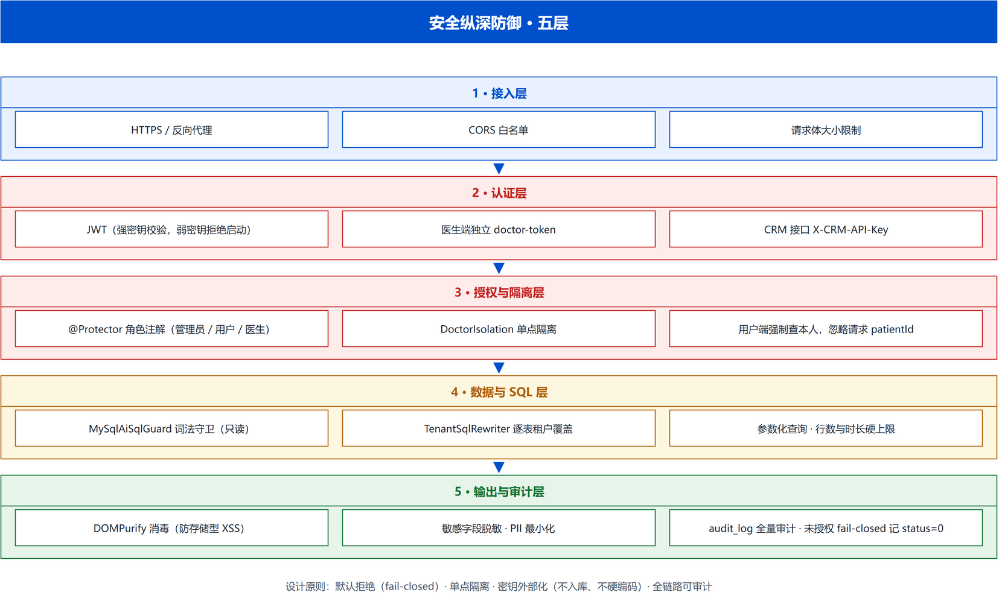

# 安全加固设计

> 版本：v5.1（2026-07-31）
> 代码位置：`personal-health-api/.../utils/JwtUtil.java`、`personal-health-api/.../Interceptor/CrmApiKeyInterceptor.java`、`personal-health-api/.../crm/sqlite/SqlGuard.java`、`personal-heath-view/.../utils/sanitize.js`、`personal-health-api/.../service/impl/AiServiceImpl.java`
> 部署与配置基线详见根目录 `../README.md`「配置说明」与「安全加固」两章

---

## 1. 认证与鉴权

### 1.1 JWT（用户端）

- `JwtUtil`：签名密钥**必须外部注入**（`JWT_SECRET` 环境变量或 `jwt.secret` 配置）；
- **启动强校验**：密钥缺失或强度不足（<32 字节）直接拒绝启动，杜绝默认/弱密钥上线；
- 默认有效期 7 天；用户密码采用 BCrypt 加盐哈希。

### 1.2 CRM API Key（机器接口 `/crm/**`）

`CrmApiKeyInterceptor`（`Interceptor/`）统一 **fail-closed** 拦截（原校验散落在各 Controller 方法，曾漏写导致匿名遍历手机号拖走全平台问诊记录——SEC-02）：

- 读取请求头 `X-CRM-API-Key`，与 `CrmConfig.getCrmApiKey()` 做**定长时间比较**（防时序爆破）；
- 服务端未配置密钥 → 一律拒绝，绝不退化为「无需认证」；
- 仅白名单放行 `/crm/health`（注册于 `config/InterceptorConfig`）；
- 设计原则：**新增接口默认受保护**，除非显式加入白名单。

### 1.3 WebSocket 一次性握手票据（阶段 11 · S6，2026-11-13）

原实现 `@ServerEndpoint("/ws/notification/{token}")` 把 **7 天有效的 JWT 拼进 URL**：URL 会落进浏览器历史、
反向代理 access log、Referer 与监控采样，任何拿到 URL 的人都能冒充该用户建立长连接。现改为：

- `GET /ws/ticket`（需登录，身份只取 `LocalThreadHolder`）签发 **256 位随机 / 30 秒 / 一次性**票据；
  注册中心 `core/auth/WsTicketRegistry` 用 `ConcurrentHashMap.remove` 做**原子消费**；
- 浏览器把票据放进 `Sec-WebSocket-Protocol: ws-ticket.<票据>`（WebSocket API 不允许自定义 Header）；
  非浏览器客户端可用 `X-WS-Ticket`。`WebSocketTicketConfigurator#modifyHandshake` 消费票据，
  把身份写入 `EndpointConfig#getUserProperties()`，`@OnOpen` 只认这份服务端换出的身份；
- 票据不存在 / 已消费 / 已过期 / 注册中心异常，一律**不写身份**并关闭连接（fail-closed）；
- 前端 `utils/ws.js` 每次建连与重连都重新取票，URL 为 `/ws/notification`，**不含任何凭证**。

⚠️ **部署限制**：票据为单实例 JVM 内存态，与 compose 单 backend 形态一致；横向扩容到多 backend
时必须换成 Redis `GETDEL` 等共享存储，否则票据会落到另一实例而校验失败。

### 1.4 refresh token 轮换（阶段 11 · A1，2026-11-13）

`POST /auth/refresh` 匿名可达（**JWT 白名单两处必须同步**：`InterceptorConfig#excludePathPatterns`
与 `JwtInterceptor#preHandle`）。`core/auth/AuthSessionManager` 负责：

- 登录时签发 refresh token（7 天 TTL），Redis 只存 **token 的 SHA-256** 作键，不落明文；
- 轮换用 `ValueOperations#getAndDelete` **原子取删**，同一枚 token 最多成功一次（重放/并发双刷新只有一个能赢）；
- 载荷带签发时的 `ver`，轮换时与当前会话版本比对 —— 登出 / 改密 / 重新登录递增 `ver` 后，
  旧 refresh 立即失效，**与既有会话版本号机制共存**，无需额外黑名单；
- 账号已锁定、载荷损坏、Redis 不可用，一律拒绝（fail-closed），不降级放行；
- 前端 `utils/request.js` 在普通 401 时静默续期并重放原请求（并发只刷一次），
  **4010 账号禁用 / 4011 系统繁忙 / 403 越权** 三条分支语义保持不变。

---

## 2. 数据访问守卫

### 2.1 SqlGuard（只读 SQL 守卫）

`crm/sqlite/SqlGuard` 对 `execute_sql` 工具做词法校验：

| 规则 | 说明 |
|------|------|
| 单语句 | 仅允许单条 `SELECT` / `WITH`，分号即拒（阻断多语句注入） |
| 关键词黑名单 | 拦截 INSERT / UPDATE / DELETE / DROP / ATTACH 等写操作 |
| 禁子查询嵌套 | 含嵌套 `SELECT` / `WITH` 视为注入风险，拒绝 |
| **租户隔离兜底** | 查询 `chat_history` 时，顶层 `WHERE` 必须 `phone_number = '当前会话手机号'`，否则拒绝——LLM 只能看到本用户记录 |

覆盖 10 个单元测试，真实抓出 3 个绕过漏洞并已修复。

### 2.2 IDOR 会话归属

`AiChatCacheServiceImpl.isOwnedBy()`（SEC-03）：以 MySQL `user_id` 为准校验会话归属，缓存命中时也校验缓存对象自带正确 `userId`，防止越权访问他人对话。

---

## 3. 内容安全

### 3.1 XSS 防护

AI 输出经前端 `utils/sanitize.js`（`DOMPurify` 封装，`sanitizeHtml`）白名单净化后再注入 DOM。`AiAnalysis.vue`、`Assistant.vue`、`NewsDetail.vue`、`CustomerServiceBall.vue`、`NavAssistant.vue` 均已接入。

### 3.2 PII 出境脱敏

`AiServiceImpl.maskProfileForExternal()`（SEC-12）：健康档案发送到第三方 LLM 前，
- 剥离联系方式类字段：`phone` / `phoneNumber` / `idCard` / `idCardNo` / `email` / `address`；
- 姓名打码（保留首字，其余替换 `*`）；
- 仅保留健康指标，避免敏感个人信息出境。

### 3.3 输出校验

`core/guard/OutputValidator`：`containsSensitiveInfo()`（敏感信息检测）、`needDisclaimer()`（医疗免责声明提示）。

---

## 4. LLM 韧性

Provider 工厂 + 轻量熔断器（`CircuitBreaker`）：上游 429 / 5xx 自动重试，OPEN 状态快速失败，避免上游故障拖垮主链路。

---

## 5. 安全配置基线（摘要）

| 项 | 现状 |
|----|------|
| 密码存储 | BCrypt 加盐哈希 |
| 登录令牌 | JWT（密钥外部注入 + 启动强校验，默认 7 天） |
| 会话越权 | AI 会话 / 文件上传归属校验（IDOR 已修复） |
| CRM 接口 | API Key 认证 + 强制租户隔离 |
| SQL 注入 | 只读 `SqlGuard`（词法校验 + 黑名单 + 禁子查询 + 租户谓词） |
| 文件上传 | 登录态 + 扩展名白名单 + 魔数校验 + 随机文件名（不可枚举） |
| XSS | AI 输出 DOMPurify 白名单净化 |
| 数据出境 | 健康档案发送第三方前自动 PII 脱敏 |
| 成本可观测 | 每次调用 token 用量落库（`ai_usage` 表） |
| 容器 | 非 root 运行、去默认密码、healthcheck |
| 日志 | 滚动归档，异常不回传前端 |

---

## 6. 合规提醒

平台处理**敏感个人信息**（健康数据），正式商用前建议：

1. 完成**等保三级**测评；
2. 开展**个人信息保护影响评估（PIA）**；
3. 对第三方 AI 厂商的数据出境做合规确认；
4. 上线前由第三方执行渗透测试（OWASP Top10 + 越权专项）。
